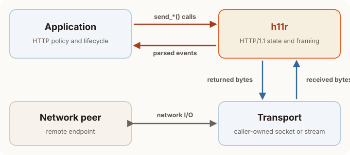

# Understand the protocol model

The [complete round trip](round-trip.md) drains events before reading more
bytes, preserves the order of outgoing bytes, and advances connection reuse
explicitly. These are the core rules behind that example.

`h11r` owns HTTP/1.1 protocol state. The surrounding program owns transport
I/O and application policy.



## Map the example to the model

The names in `round_trip.py` correspond directly to the general pieces:

| In the round-trip example | General responsibility |
| --- | --- |
| `client` and `server` | One `Connection` for each endpoint's protocol view |
| `client_socket` and `server_socket` | The caller-owned byte transport |
| `next_event()` | Drain buffered events and read only on `NEED_DATA` |
| `receive_request()` and `receive_response()` | Application handling of a complete HTTP message |
| `sendall(...)` | Caller-owned delivery of bytes returned by `h11r` |

## One connection, one endpoint

One `Connection` represents one endpoint's HTTP view of one transport
connection. Choose `Role.CLIENT` or `Role.SERVER` when constructing it.

The object tracks both the local and peer actor states. It does not own a
socket, task, timeout, or application handler.

Create independent `Connection` instances for independent transports. Separate
instances may run in parallel. Calls on one instance still have protocol order
and must be serialized by the caller.

## Receiving: bytes become events

Pass each received byte sequence to `receive_data()`, then call `next_event()`
until the connection asks you to stop.

`next_event()` returns:

- `Request`, `InformationalResponse`, or `Response` for a message head;
- zero or more `Data` events for a body;
- `EndOfMessage` for the message boundary and optional trailers;
- `ConnectionClosed` for a clean peer EOF;
- `ReceiveStatus.NEED_DATA` when another transport read is required;
- `ReceiveStatus.PAUSED` at a connection-cycle or protocol-switch boundary.

!!! important

    `NEED_DATA` and `PAUSED` are different. Reading more bytes can satisfy
    `NEED_DATA`. More bytes cannot advance `PAUSED`; finish the active cycle or
    hand the transport to the
    [selected protocol](advanced.md#protocol-handoff).

A transport read can contain part of one event or several complete messages.
Likewise, one HTTP body can produce any number of `Data` events. Use
`EndOfMessage`, not read length, to recognize completion.

When a transport read returns `b""`, pass that empty value to `receive_data()`.
The connection can then distinguish a clean close from a truncated message.

Message heads and trailers are `h11r.Headers`, a sequence of `(name, value)`
byte pairs in wire order. `headers.get("content-type")` returns the first
value or `None`, and `headers.get_all("vary")` returns every value; both match
names case-insensitively.

`h11r` removes only the transfer framing that RFC 9112 defines. It decodes
`chunked` and leaves any other transfer coding, such as `gzip` in
`Transfer-Encoding: gzip, chunked`, in the `Data` bytes for the application to
decode. A response whose last transfer coding is not `chunked` has no length,
so its body ends when the connection closes (RFC 9112 Section 6.3). A request
in that form is rejected, because a server could not find its end.

## Sending: calls return wire bytes

Sending has one ordering rule:

1. Call `send_request()`, `send_response()`, `send_data()`, or
   `end_of_message()`.
2. Write every returned byte to the transport in the same order.

The send call updates protocol state before returning. If the caller discards
or reorders returned bytes, its local state no longer describes what the peer
received.

## Connection cycles

An HTTP/1.1 keep-alive connection can carry multiple request/response cycles.
Call `start_next_cycle()` only after the request and response for the current
cycle are complete and reuse remains legal.

After each exchange, check `keep_alive`. When it is false, close the transport
instead of calling `start_next_cycle()`. It becomes false when either message
asks to close, an HTTP/1.0 message lacks `Connection: keep-alive`, a body ends
at close, a client receives EOF, a protocol error occurs, or HTTP hands the
connection to another protocol.

Pipelined bytes may already be buffered. `h11r` returns `PAUSED` until the
current response is complete, preserving request and response order. After
`start_next_cycle()`, the next buffered request becomes available.

A client never pipelines, so bytes that arrive after a complete response belong
to no request. A client-role `start_next_cycle()` refuses to reuse such a
connection, and `keep_alive` becomes false.

## Errors and resource limits

`LocalProtocolError` means the caller requested an operation that is invalid
for the current state or framing.

`RemoteProtocolError` means peer input violated HTTP syntax, framing, state, or
an inbound limit. A server can still send one final response, using
`suggested_status_code` when it is not `None`, and should then close the
transport. `h11r` marks that response with `Connection: close`, as it does any
response sent before the request body has been fully received.

Each connection applies independent inbound limits:

```python
connection = h11r.Connection(
    h11r.Role.SERVER,
    max_head_bytes=64 * 1024,
    max_header_count=100,
)
```

These limits cover request or response heads, trailer sections, each
chunk-size line, and the total chunk-extension bytes of one message. A section
that is invalid within the byte limit fails with the same error however the
transport splits it. Application body limits, timeouts, concurrency limits, and
transport back-pressure remain the caller's responsibility. Bytes received
while `next_event()` returns `PAUSED` also stay buffered until the caller acts
on them.

## Strict and lenient parsing

By default `h11r` is exactly as strict as RFC 9110 and RFC 9112: it rejects
what they forbid and accepts what they require recipients to accept, such as
empty list elements. Some servers send response heads that break the syntax
in ways browsers and mainstream clients tolerate. A client can accept those:

```python
connection = h11r.Connection(h11r.Role.CLIENT, lenient=True)
```

A lenient connection, for received responses only:

- drops field lines that are not valid fields, such as a name containing `/`;
- accepts whitespace between a field name and its colon;
- accepts more than one space between status-line elements.

A connection that drops a field line is not reused, since the dropped line may
have been a framing field. Requests are never parsed leniently: a server that
tolerates malformed requests can frame them differently from another server
on the path, which enables request smuggling.

With those ownership and ordering rules in place, continue to
[Build a transport adapter](integration.md) and apply them to an existing
synchronous or asynchronous byte stream.
